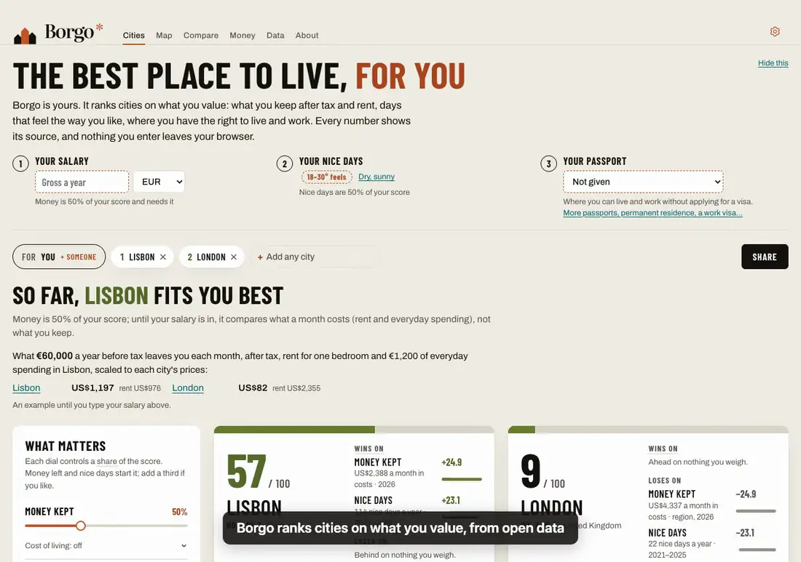
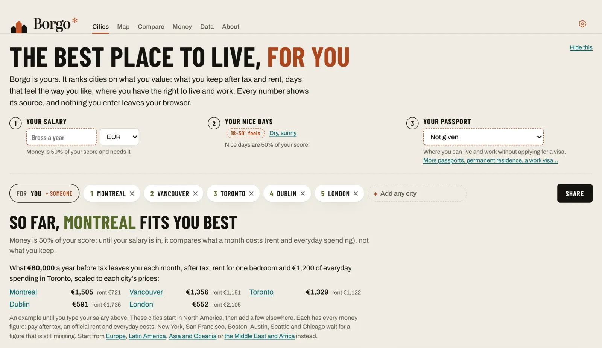
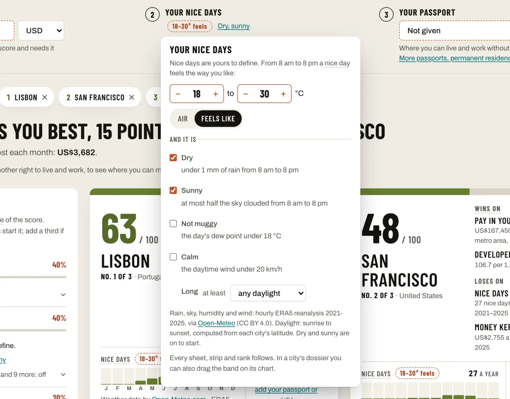
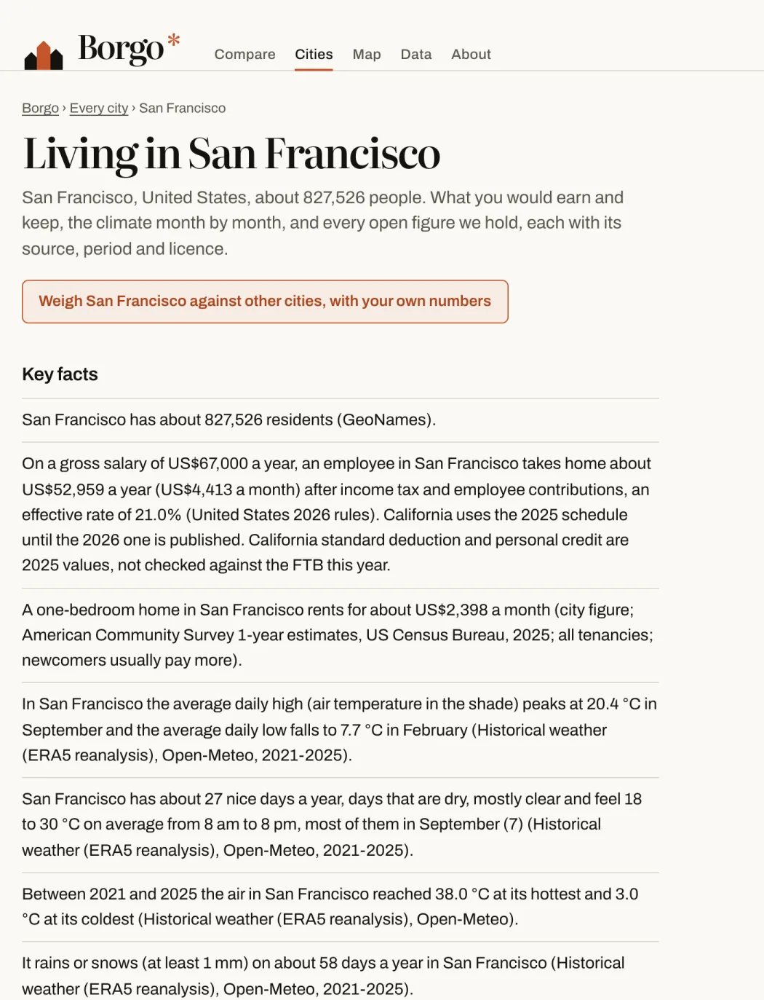

# Borgo

[](https://github.com/ABCastor/borgo/actions/workflows/checks.yml?query=branch%3Amain)

Borgo (Italian for a village) compares any number of cities on open data, weighted by what you value: what you would earn after tax and keep after rent, who in your household can move there without a visa, and how each place does on climate, air, safety, health and research. Every figure shows its source, the period it describes, and whether it describes the city itself or only its country.

It runs in the browser at https://borgo.abcastor.com with no account, and what you type stays there. The same engine runs as a command-line tool (`borgo`) and as an [MCP](https://modelcontextprotocol.io) server, the protocol AI assistants use to call tools, so an assistant can answer "where should I live?" with the numbers you would see.

<p><a href="docs/media/borgo-demo.mp4?raw=true"></a></p>

<sub>34 seconds, silent. [Download the full-size MP4](docs/media/borgo-demo.mp4?raw=true) (4 MB).</sub>

> **Why I built this:** I was deciding with a co-founder where to live and start a company, weighing San Francisco, London and Dublin against staying here in Torino. When I put together my own comparison, every site I pulled from answered one slice: one had price levels, another weather, another a salary calculator, and none weighted them by what mattered to me or said whether both of us could legally work there. Teleport, which once put those pieces together, is gone. So I built the comparison I wanted and made it open, for anyone (or their agent) to run with their own weights.

**Status:** early. Any city can be fetched on demand; 57 have public pages, and 49 of those have an official rent. Take-home pay covers 26 countries (most of Europe, the United Kingdom, the United States with eight state modules and New York City, Canada, Australia, Singapore, Japan and the UAE), with 17 tax regimes for people moving in, their conditions and how long they last.

## In an AI assistant

One address, nothing to install: **`https://borgo.abcastor.com/mcp`** (MCP over Streamable HTTP, no account).

```sh
claude mcp add --transport http borgo https://borgo.abcastor.com/mcp    # Claude Code
codex mcp add borgo --url https://borgo.abcastor.com/mcp                # Codex
```

In Claude (web or desktop) or ChatGPT, add a custom connector with that address. It answers for the 57 published cities. It keeps none of what you send; it counts calls per tool, nothing more.

To compare any other place, or to keep everything on your own machine, run the same server locally with [Node.js](https://nodejs.org/) 22.13 or newer:

**Claude Code**

```sh
claude mcp add borgo -- npx -y @abcastor/borgo mcp
```

**Claude Desktop, Cursor** and other JSON-configured clients:

```json
{
  "mcpServers": {
    "borgo": {
      "command": "npx",
      "args": ["-y", "@abcastor/borgo", "mcp"]
    }
  }
}
```

**Codex**

```sh
codex mcp add borgo -- npx -y @abcastor/borgo mcp
```

[docs/agents.md](docs/agents.md) lists every tool and where each client keeps its configuration.

## In the terminal

```sh
npx -y @abcastor/borgo compare "San Francisco" London \
  --salary "120k USD" --spending "1500 USD" --home "San Francisco" \
  --health-premium "San Francisco=250/month"
```

```
**San Francisco ranks first on your weights, 60.1/100. London is within 0.3 points: a near tie.**

| # | City | Score /100 | Observed | Left a month (USD) |
| ---: | --- | ---: | ---: | ---: |
| 1 | San Francisco | 60.1 | 73% | US$2,794 |
| 2 | London | 59.8 | 83% | US$3,163 |
```

On the same pay, London leaves $369 more a month. San Francisco still edges ahead on dry days, winter daylight and research output. Below this, the answer lists every line's points with its source, the tax on each salary, and what to add next.

No open source publishes a health insurance premium for San Francisco, which is why the command passes one. Without it, San Francisco's money reads "at most US$3,044" and stays out of the score until you give a figure.

Any real place works, with or without a public page: `borgo fetch "Oakland, US"` reads every source that covers it into your cache. `npm install -g @abcastor/borgo` installs the `borgo` command; the full list of commands and flags is in [docs/agents.md](docs/agents.md#cli).

From a clone, with Node.js 26 or newer, which runs the TypeScript sources directly:

```sh
git clone https://github.com/ABCastor/borgo && cd borgo
npm install
node pipeline/build-data.ts      # assemble data/ into public/data/dataset.json, refusing anything unsourced
node scripts/build.ts --serve    # build dist/ and serve it at http://127.0.0.1:8794/
npm test                         # engine, money model and tax modules
```

## In the browser

A first visit starts in your region with five cities whose money figures are complete, and shows what an example salary leaves each month after tax, rent and everyday spending. Type your own salary and it takes over.

<p></p>

Money left and nice days start the score at half each, and a third priority such as health or safety is one click away. Nice days are yours to define: a feels-like range, 18 to 30 °C to start, and the tests a day must pass.

<p></p>

**Right to live and work** checks each person's passports and other rights, such as permanent residence or an EU Blue Card. Click any figure to see where it came from or to replace it with your own. **Share** shows what its link carries before you copy it; pay, passports and your own numbers stay out unless you tick them.

How each screen behaves, the map that colours the world by your own values, and what the share link carries are in [docs/architecture.md](docs/architecture.md#37-the-app-from-the-first-visit).

## How the score works

Each line turns one figure into a score from 0 to 1 between a fixed worst and best (fine dust from 35 µg/m³ down to the WHO guideline of 5), and your weight decides how many of the 100 points it can give. Three rules keep gaps from deciding the answer:

- **A missing figure never scores better than a real one.** A city without a figure on a line scores as the lowest of your other cities there, and is marked "Partial data".
- **Money is never filled in.** When a city lacks rent or a cost that is due, every city is compared on take-home pay alone, and one line names the input that would fix it.
- **A *must pass* line passes, fails or is unknown.** An unknown city ranks after every city that passes.

"What you keep" is take-home pay after tax and pension contributions, minus rent, everyday spending scaled by the city's prices, childcare after public support, and health costs. The full rules are in [docs/architecture.md](docs/architecture.md#35-engine-and-merge), the tax models and newcomer regimes in [docs/tax-regimes.md](docs/tax-regimes.md).

## Where the data comes from

<p></p>

| What | Source | Licence | Level |
|---|---|---|---|
| Place, coordinates, population, region | [GeoNames](https://www.geonames.org/) (through Open-Meteo's geocoder), [Wikidata](https://www.wikidata.org/) | CC BY 4.0, CC0 | city |
| Air and feels-like temperature, hourly temperature, cloud, wet days | [Open-Meteo](https://open-meteo.com/) (ERA5 reanalysis, last five full years) | CC BY 4.0 | city coordinates |
| Sunshine, measured | [WMO 1991-2020 normals](https://www.ncei.noaa.gov/products/wmo-climate-normals) (NOAA NCEI), [Meteostat](https://dev.meteostat.net/) | WMO policy, CC BY 4.0 | nearest station |
| Fine dust (PM2.5) | [WHO Ambient Air Quality Database](https://www.who.int/data/gho/data/themes/air-pollution/who-air-quality-database), else [CAMS](https://open-meteo.com/en/docs/air-quality-api) modelled | WHO terms, CC BY 4.0 | city |
| Rents | Official statistics in 19 countries, among them the [US Census ACS](https://www.census.gov/programs-surveys/acs), [ONS](https://www.ons.gov.uk/economy/inflationandpriceindices/datasets/priceindexofprivaterentsukmonthlypricestatistics) (UK), [CMHC](https://www150.statcan.gc.ca/t1/tbl1/en/tv.action?pid=3410013301) (Canada), [INE](https://dados.gov.pt/datasets/valor-mediano-das-rendas-de-novos-contratos-de-arrendamento-de-alojamentos-familiares-nos-ultimos-12-meses-metodologia-2026-eur-m2-0014696) (Portugal), [Zensus 2022](https://ergebnisse.zensus2022.de/datenbank/online/statistic/4000W/table/4000W-0009) (Germany) and [OMI](https://www.agenziaentrate.gov.it/portale/web/guest/schede/fabbricatiterreni/omi/pubblicazioni/rapporti-immobiliari-residenziali) (Italy); every one with what it measures in [docs/data-sources.md](docs/data-sources.md#rent-what-each-source-measures) | each publisher's own: public domain, OGL, CC BY 4.0, national reuse terms | city or region |
| Pay by kind of work | [BLS OEWS](https://www.bls.gov/oes/) (US), [ONS ASHE](https://www.ons.gov.uk/employmentandlabourmarket/peopleinwork/earningsandworkinghours/bulletins/annualsurveyofhoursandearnings/latest) (UK), [Eurostat Structure of Earnings Survey](https://ec.europa.eu/eurostat/web/microdata/structure-of-earnings-survey) (EU and EFTA), Statistics Canada, ABS, ILOSTAT; see [docs/work.md](docs/work.md) | public domain, OGL, CC BY 4.0, Eurostat reuse with acknowledgement | metro area, region or country |
| Price levels, homicides, life expectancy, doctors, unemployment | [World Bank WDI](https://databank.worldbank.org/source/world-development-indicators) | CC BY 4.0 | country |
| Control of corruption | [World Bank Worldwide Governance Indicators](https://www.worldbank.org/en/publication/worldwide-governance-indicators) | CC BY 4.0 | country |
| Politics, left to right | Latest national election: official results from the electoral authorities, party positions from [ParlGov](https://doi.org/10.7910/DVN/2VZ5ZC); 18 countries, Swiss cantons, Canadian provinces and Australian states, no figure where too little of the vote is positioned; see [docs/positions.md](docs/positions.md) | CC BY 4.0 (as compiled here) | country, canton, province or state |
| Abortion law, same-sex couples in law | The statutes, each cited | official texts | country, or US state |
| Life satisfaction | [OECD Well-being Database](https://www.oecd.org/en/data/datasets/well-being-database.html) | OECD terms | country |
| Research output per resident | [OpenAlex](https://openalex.org/) institutions | CC0 | city |
| Developers on GitHub per 1,000 residents | [GitHub user search](https://docs.github.com/en/rest/search/search#search-users): total counts of profiles by location only | no data licence; counts only (GitHub Acceptable Use Policies) | city |
| Distance to the edge of the built-up city | [GHSL Urban Centre Database 2025](https://human-settlement.emergency.copernicus.eu/ghs_ucdb_2024.php) (European Commission, JRC) | CC BY 4.0 | city |
| Adults with a degree | [Eurostat regional labour force survey](https://ec.europa.eu/eurostat/databrowser/view/edat_lfse_04/default/table) (edat_lfse_04) | Eurostat reuse with acknowledgement | region |
| Walkable streets, cycle network | [OpenStreetMap](https://www.openstreetmap.org/copyright) via the Overpass API | ODbL 1.0 | city |
| The world map: land, countries, towns | [Natural Earth](https://www.naturalearthdata.com/) 1:50m countries, 1:10m populated places | Public domain | country, town |
| The world map: afternoon high by month | [NASA POWER](https://power.larc.nasa.gov/) climatology (MERRA-2, 2001-2025) | CC0 | grid of about 50 km, averaged per map tile |
| Free movement | EU Directive 2004/38/EC, the EEA Agreement, the EU-Swiss agreement, the UK-Ireland Common Travel Area, the Trans-Tasman arrangement | official texts | country |

`registry/` holds one file per source: what it measures, its licence, whether it may be redistributed, and how to fetch it. The browser, the CLI or your local MCP server fetch from those sources for the places you ask about and keep each figure, with the address it was read from, on your side. The 57 seed cities ship with a snapshot of open-licensed figures for their public pages.

Numbeo, WeatherSpark, the EIU and similar closed sources are link-only: their terms forbid copying and automated reading, so the app links to them and no agent fetches them.

**Sunshine is measured at weather stations.** Reanalysis models overstate it by 30 to 90% against stations (ERA5 gives London 2,765 hours a year; Heathrow measures 1,595), so a city with no station close enough has no sunshine figure. San Francisco is one of them.

**Rent is the hardest gap.** No open source gives a one-bedroom rent for cities worldwide. Nine of the 57 seed cities have no official rent yet (Brussels, Copenhagen, Prague, Warsaw, Krakow, Budapest, Athens, Tallinn and Dubai), and there the app asks for your own figure. Every source, its coverage and its known caveats are in [docs/data-sources.md](docs/data-sources.md).

**Politics and the law are position lines.** You say where you stand and a place scores by how close it is; until you do, those lines show the fact and count for nothing. See [docs/positions.md](docs/positions.md).

## Figures people add

Anyone can add what they pay and earn where they live, without an account: rent, six everyday prices, take-home pay by kind of work, and a 1 to 5 rating. Use the form on any city page or the MCP tool `submit_figures`. Nothing about the sender is kept, an automated review holds outliers, and what passes shows labelled as community beside the official figures, never in a score. Every entry is open data under CC BY 4.0 ([JSON](https://borgo.abcastor.com/api/community/dataset.json), [CSV](https://borgo.abcastor.com/api/community/dataset.csv)).

## Contributing

**Corrections** to any figure, rule or source are welcome from people and their agents: **Suggest a correction** under any figure's sources, the [proposal form](https://github.com/ABCastor/borgo/issues/new?template=proposal.yml), or `propose_change` in the local MCP server. Each one cites the official text it comes from. New sources, metrics and tax models are small separate files; [CONTRIBUTING.md](CONTRIBUTING.md) says where each goes and what a pull request needs.

## Licence

Code under the [Apache License 2.0](LICENSE). Compiled data under [CC BY 4.0](https://creativecommons.org/licenses/by/4.0/), with each source's own licence kept beside its figures. Fonts under the SIL Open Font License, with their licence files in `public/fonts/`. The Map follows the spirit of Nick Winans' [Where to Live](https://github.com/Nicell/where-to-live) map of pleasant days in the US (MIT); no code is copied from it.

<p><a href="https://abcastor.com"></a></p>
